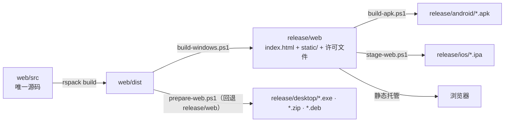

# 架构说明

一份网页源码（`web/src`）驱动四个平台外壳，本文说明代码分层、数据流与构建链路。

## 技术栈

| 层 | 选型 |
| --- | --- |
| 界面 | React 18 + CSS Modules + 自研轻量组件（`components/base`） |
| 状态 | Zustand：`services/settings`（本机设置）、`services/chat/store`（会话与消息） |
| 构建 | rspack + SWC + lightningcss，产物为纯静态文件 |
| 存储 | IndexedDB `chat-demo`（会话 / 附件 / 头像 / 表情）+ localStorage（设置与轻量索引） |
| 渲染 | 自研 Markdown 渲染（含代码高亮、KaTeX、Mermaid） |
| 接口 | DeepSeek API（兼容 Anthropic Messages 协议，流式 SSE） |
| 外壳 | Electron 37 / Android WebView / iOS WKWebView |

## 目录与分层

```text
web/src/
├─ app/           应用外壳：App、主题、视口断点、返回键
├─ components/    界面层（base 通用组件 / session 会话页 / messages 消息 / settings 设置 / casual 休闲模式 …）
├─ services/      业务层（api 请求与事件解析、chat 会话与存储、speech、settings）
├─ utils/         无业务语义的工具（压缩图片、格式化、打开附件）
├─ i18n/          中英文文案（zh 为键的唯一来源，en 用 satisfies 校验完整性）
└─ assets/        图标与图片
```

依赖方向单向向上：`components → services → utils`，`utils` 不感知业务；界面层不直接访问 IndexedDB。

## 关键模块

| 模块 | 职责 |
| --- | --- |
| `services/api/client.ts` | 组装请求、鉴权头、错误归类（密钥失效 / 限流 / 图片超限 / 网络） |
| `services/api/parseEvent.ts` | 解析 SSE：`message_start` / `content_block_*` / `message_delta` |
| `services/chat/store.ts` | 会话与消息状态、发送 / 重试 / 续写 / 停止 / 分支切换，写入 IndexedDB |
| `services/chat/reply.ts` | 把本地消息转换为请求消息：摘要替换、图片预算、上下文去重 |
| `services/chat/imageBudget.ts` | 按出现次数计费的图片预算（体积 / 张数双上限） |
| `services/chat/summary.ts` | 增量摘要与整理（只追加、不重写，超过字数才整理） |
| `services/chat/db.ts` | IndexedDB 结构与访问（版本 13） |
| `services/chat/fileIndex.ts` | 按内容 SHA-256 的附件去重索引 |
| `services/chat/history/` | 官方格式 ZIP 的导入 / 导出 / 校验（流式读写） |
| `components/messages/MessageList.tsx` | 窗口化渲染（只挂载可视窗口 + 目标附近）、分页与懒加载、跟随底部 / 回到底部、会话总览跳转 |
| `components/session/SessionView.tsx` | 会话页骨架：标题栏、消息列表、输入框；向子组件暴露输入框实测高度 |

## 数据流

**发送一条消息**

```text
ChatInput → store.sendMessage
  → reply.toRequestMessages（摘要替换 + 图片预算 + 上下文去重 + 对话提示词）
  → api/client（x-api-key / Authorization，SSE 流）
  → parseEvent → 逐步写入当前 assistant 消息（thinking / text / 工具块）
  → components 逐帧渲染（流式文本按帧节流合并）
  → 结束时落库：messages、sessionSummaries、files
```

**展示一条回答**

```text
AssistantMessage → useReplyView（把 blocks 归并为「思考 / 工具步骤 / 正文 / 来源」）
  → ReplyArea（时间线 + 折叠标题）→ Markdown（代码 / 公式 / 脑图）
```

**上下文压缩**：轮数超过阈值时，把「最近 10 轮以前」的原文改为「摘要（user）+ 确认（assistant）」，
摘要只存本机，可手动触发，失败时保留旧摘要与游标。

## 本地存储

**IndexedDB `chat-demo`（v13）**

| store | 内容 |
| --- | --- |
| `sessions` | 会话与其消息树（含分支关系） |
| `sessionSummaries` | 会话摘要与游标，`fileIds` 多值索引用于引用计数 |
| `files` | 附件原件（Blob） |
| `fileHashes` | 内容哈希 → 附件 id / serverId（上传去重） |
| `sessionAvatars` / `stickers` | 会话头像、表情包 |
| `sessionsStaging` / `filesStaging` | 导入过程的暂存区，成功后整体替换 |

**localStorage**

| 键 | 用途 |
| --- | --- |
| `chat-demo:api-key` | API Key（仅本机） |
| `chat-demo:locale` / `theme-preference` / `tts-voice` | 语言、主题、朗读音色 |
| `chat-demo:thinking` / `search` / `auto-summary` / `collapse-thinking` | 深度思考、智能搜索、自动摘要、折叠思考 |
| `chat-demo:ui-mode` / `ui-scale` / `sider-collapsed` | 界面模式、缩放、侧边栏状态 |
| `chat-demo:session-prompts` / `session-summaries` | 按会话的提示词与摘要 |
| `chat-demo:pinned-sessions` / `session-activity` / `casual-hidden` | 置顶、最近使用、主页隐藏 |
| `chat-demo:debug` | 设为 `1` 后暴露 `window.__dsc`，仅用于自动化核对 |

## 多端复用与原生桥



- 复用方式是**文件复制**，没有 workspace 或软链接，因此四端网页代码永远一致；
- 下载桥脚本 `native/download-bridge.js` 只在构建时注入一次，三端共用；
- 原生能力通过 `window.DeepseekNative` 暴露：下载（开始 / 分块写 / 结束 / 取消）、打开附件、错误提示。
  Android 用 `@JavascriptInterface`，桌面用 `contextBridge` + IPC，iOS 用 `WKScriptMessageHandler`；
  纯浏览器没有原生壳时自动降级。

## 构建管线

| 阶段 | 命令 | 产物 |
| --- | --- | --- |
| 网页 | `web/build-windows.ps1` | `release/web/`（153 个静态文件 / 88 个按需 chunk） |
| Android | `android/build-apk.ps1` | `release/android/Deepseek Chat Only.apk` |
| Windows | `desktop/build-win.ps1` | `release/desktop/*.exe`、`*-win.zip` |
| Debian | `desktop/build-deb.sh` | `release/desktop/*.deb` |
| iOS | `ios/build-ipa.sh`（macOS） | `release/ios/*.ipa` |

统一约定：

- 所有成品只落 `release/<平台>/`，仓库根只放源码；
- 许可文件随产物走：`release/web/` 里同时有 GPLv3 `LICENSE`、`NOTICE` 与
  `LICENSES/MIT-deepseek-chat-demo.txt`，四端打包时原样带上；
- 版本号只读根目录 `VERSION`（格式 `x.xxx.xx`）；
- 脚本自定位（`.ps1` 用 `$PSScriptRoot`，`.sh` 用 `BASH_SOURCE`），项目目录搬迁不需要改脚本；
- `.ps1` 存为 UTF-8 with BOM，`.sh` 用 LF（`.gitattributes` 强制），避免 PowerShell 5.1 代码页与 CRLF 问题。

## 扩展指南

- **新增平台**：在 `prepare-web` 之外加一个「取 `release/web` → 复制进目标工程」的脚本即可，
  网页侧只需保证 `window.DeepseekNative` 不存在时能降级。
- **新增模型能力**：在 `services/api/types.ts` 补事件与块类型，在 `services/chat/view.ts` 归并到渲染视图，
  界面层只消费视图，不直接读协议。
- **新增设置项**：在 `services/settings.ts` 加字段 + localStorage 键 + setter，
  在 `components/settings/SettingsDialog.tsx` 的「通用设置」里加一行 `SettingCell`。
- **新增文案**：只改 `i18n/zh.ts`，再补 `i18n/en.ts`（类型会强制校验键齐全）。
